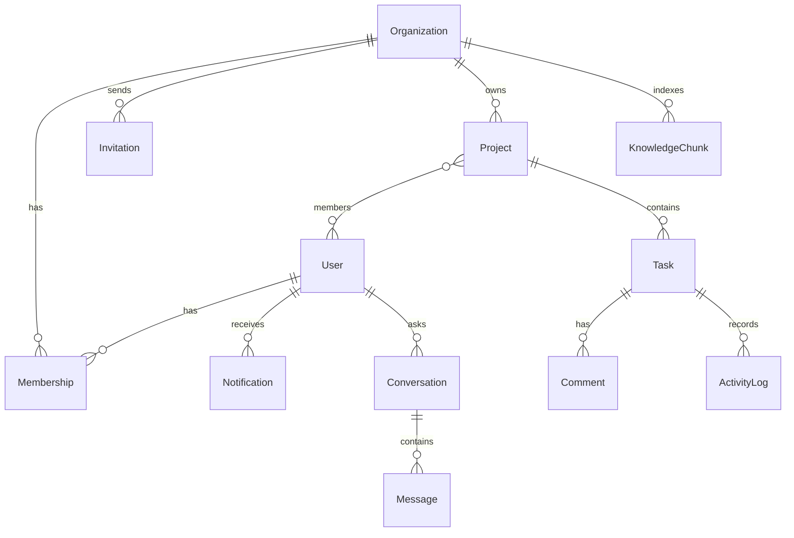
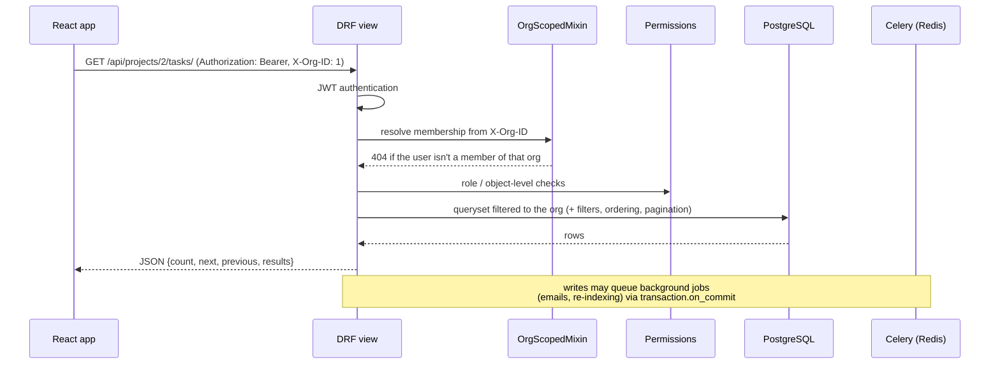
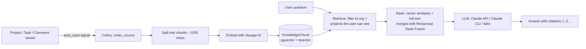

# TaskHub Backend: Project Overview

TaskHub is a **multi-tenant project and task management platform** (think a lightweight Jira or Asana). This repository is the **REST API**. The React frontend lives in the separate `taskhub-frontend` repo and talks to this API over JWT.

Each **Organization** is a tenant with its own members, projects, tasks and notifications. A user can belong to several organizations, but data from one organization is never visible from another.

---

## Tech stack

| Area | Technology | Used for |
|---|---|---|
| Language | Python 3.14 | |
| Framework | Django 6.1 | ORM, admin, migrations, settings |
| API | Django REST Framework 3.18 | ViewSets, serializers, routers, permissions |
| Auth | djangorestframework-simplejwt | JWT access and refresh tokens, rotation and blacklist on logout |
| Database | PostgreSQL 17 (`pgvector/pgvector:pg17`) | Main data store, full-text search |
| Vector search | pgvector + `pgvector` Python package | Embeddings for the Ask TaskHub assistant |
| Filtering | django-filter | Query-string filters on lists |
| API docs | drf-spectacular | OpenAPI schema + Swagger UI |
| CORS | django-cors-headers | Lets the React dev server call the API |
| Config | django-environ | Settings from `.env` |
| Background jobs | Celery 5.7 + Redis 7 | Emails, due-date reminders, search indexing |
| Scheduling | Celery Beat | Daily due-date reminder job |
| AI | Voyage AI (embeddings), Anthropic Claude (answers) | Ask TaskHub retrieval-augmented answers |
| Testing | pytest, pytest-django, pytest-cov, factory_boy | Unit and API tests with coverage |
| CI | GitHub Actions | Runs checks and tests against Postgres + Redis on every push |
| Dev services | Docker Compose | Postgres, Redis and pgAdmin |
| Production server | Gunicorn | WSGI server (deployment) |

---

## Folder structure

```
config/
  settings/          base.py, dev.py, test.py, prod.py (read from .env)
  celery.py          Celery app
  urls.py            all API routes + /api/docs/
apps/
  core/              tenancy mixin (X-Org-ID), shared permissions, pagination,
                     TimeStampedModel, health check, demo data (seed_demo)
  accounts/          custom User (logs in with email), register, /auth/me/
  organizations/     Organization, Membership (roles), Invitation
  projects/          Project, project members, archive/unarchive
  tasks/             Task, Comment, ActivityLog, Kanban "move" logic
  notifications/     Notification model, notify services, Celery email jobs
  dashboard/         one aggregated stats endpoint
  assistant/         Ask TaskHub: chunks, embeddings, retrieval, LLM, chat API
requirements/        base.txt, dev.txt, prod.txt
docker-compose.yml   db (Postgres + pgvector), redis, pgadmin
```

---

## Data model



- **Membership roles:** `owner`, `admin`, `member` or `viewer`.
- **Task fields:**
  - `status`: `todo`, `in_progress`, `review` or `done`
  - `priority`: `low`, `medium`, `high` or `urgent`
  - `assignee`, `reporter` and `due_date`
  - `labels`, a Postgres array
  - `position`, the task's order within its Kanban column
- **Timestamps:** every model extends `TimeStampedModel`, which adds `created_at` and `updated_at`.

---

## How a request flows



1. **Authentication:**
   - The frontend gets an access and refresh token pair from `POST /api/auth/login/`.
   - Access tokens last 15 minutes and refresh tokens 7 days.
   - Each refresh issues a new refresh token, and the old one is blacklisted.
2. **Tenancy:** every request that works inside an organization sends an `X-Org-ID` header. `apps/core/tenancy.py` turns it into the user's membership.
   - It returns 400 if the header is missing.
   - It returns **404** if the user isn't a member, so outsiders can't tell which organizations exist.
   - Every queryset is filtered to that organization, and `organization` is set on the server, never taken from the request body.
3. **Permissions:**
   - **Viewer:** read-only.
   - **Member:** can create and edit tasks in projects they belong to.
   - **Admin:** can also manage projects, members and invitations.
   - **Owner:** can do everything, including deleting the organization.
   - Object-level classes such as `CanEditTask` and `CanComment` check each object.
4. **Lists:** support django-filter filters, `?search=`, `?ordering=` and page-number pagination (20 per page).
5. **Writes that change tasks:**
   - They create **ActivityLog** entries recording who changed what.
   - Assignments and comments create **Notifications**.
   - Some changes queue **Celery** jobs.

---

## Main features and their flow

### Organizations and invitations
1. A user registers, logs in and creates an organization, becoming its **owner**.
2. An owner or admin invites someone by email with a role. The invitation gets a token and an expiry date, and the email is sent by a Celery job.
3. The invitee opens the link and calls `POST /api/invitations/accept/`, which creates their Membership.

### Projects and tasks (Kanban)
1. **Projects:** created inside an organization, with selected organization members added to each project.
2. **Tasks:** created inside a project, with a status, priority, assignee, due date and labels.
3. **Moving on the board:** `PATCH /api/tasks/{id}/move/` with a status and position. `tasks/services.move_task` renumbers the cards in both columns so their order stays consistent.
4. **Logging:** every create, update, move or comment writes an `ActivityLog` row recording the changed fields.

### Notifications
- **Assigned task or new comment:** `notify()` creates an in-app Notification immediately. The email is sent later by the Celery job `send_notification_email`, queued with `transaction.on_commit`.
- **Due-date reminders:** a **Celery Beat** job, `send_due_date_reminders`, runs daily at 08:00 UTC and reminds people about open tasks due tomorrow. A `dedupe_key` stops duplicate reminders.
- **API:** list notifications, get the unread count, mark one or all as read, and delete.

### Dashboard
`GET /api/dashboard/` returns everything the dashboard page needs in one call:
- my open, overdue and due-this-week tasks
- organization-wide totals
- counts by status and by priority
- unassigned and recently completed tasks
- project and member counts

### Ask TaskHub (AI assistant, RAG)

- **Permission filtering comes first:** chunks are limited to what the user is allowed to see *before* any ranking, so other organizations' data can never reach the model.
- **Model options:** `ASSISTANT_LLM_BACKEND` is `api` (Anthropic API), `cli` (your logged-in Claude Code, local only) or `fake` (offline demo and tests). `ASSISTANT_EMBEDDER` is `voyage` or `fake`.
- **Rate limit:** questions are limited to `30/hour` per user by default.

---

## API overview

| Area | Endpoints |
|---|---|
| Auth | `POST /api/auth/register/`, `login/`, `refresh/`, `logout/`, `GET/PATCH /api/auth/me/` |
| Organizations | `/api/organizations/`, `/api/members/`, `/api/invitations/`, `POST /api/invitations/accept/` |
| Projects | `/api/projects/`, `POST /api/projects/{id}/archive/` and `unarchive/`, `/api/projects/{id}/members/` |
| Tasks | `/api/projects/{project_id}/tasks/`, `/api/tasks/`, `PATCH /api/tasks/{id}/move/` |
| Comments and activity | `/api/tasks/{id}/comments/`, `GET /api/tasks/{id}/activity/` |
| Notifications | `/api/notifications/`, `unread-count/`, `read-all/`, `{id}/read/` |
| Dashboard | `GET /api/dashboard/` |
| Assistant | `/api/assistant/conversations/`, `POST /api/assistant/conversations/{id}/messages/` |
| System | `GET /api/health/`, `/api/schema/`, `/api/docs/` (Swagger UI) |

The full interactive reference is at **http://localhost:8000/api/docs/** while the server is running.

---

## Running locally (Windows / PowerShell)

```powershell
py -m venv .venv
.\.venv\Scripts\Activate.ps1
pip install -r requirements\dev.txt
copy .env.example .env               # set SECRET_KEY; for the offline demo assistant add:
                                     # ASSISTANT_EMBEDDER=fake and ASSISTANT_LLM_BACKEND=fake
docker compose up -d                 # Postgres (5432), Redis (6380), pgAdmin (5050)
python manage.py migrate
python manage.py seed_demo           # optional: Pixel Forge Studio demo data
python manage.py runserver           # http://localhost:8000
```

**Optional background workers:**

```powershell
celery -A config worker -l info -P solo   # emails + indexing (-P solo is required on Windows)
celery -A config beat -l info             # daily due-date reminders
```

**Demo logins:** `priya@pixelforge.dev` (owner), `arjun@…` (admin), `neha@…` and `rohan@…` (members), `kavya@…` (viewer). Password: `DemoPass!2026`. To reset the demo data, run `python manage.py seed_demo --reset`.

## Testing

```powershell
pytest                                     # all tests
pytest --cov=apps --cov-report=term-missing
```

Every endpoint has tests, including **tenant-isolation tests** proving that a user from one organization can't list, read, update or delete another organization's data. GitHub Actions runs the same suite on each push.
